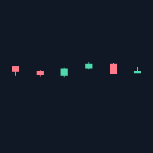
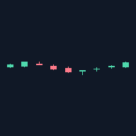
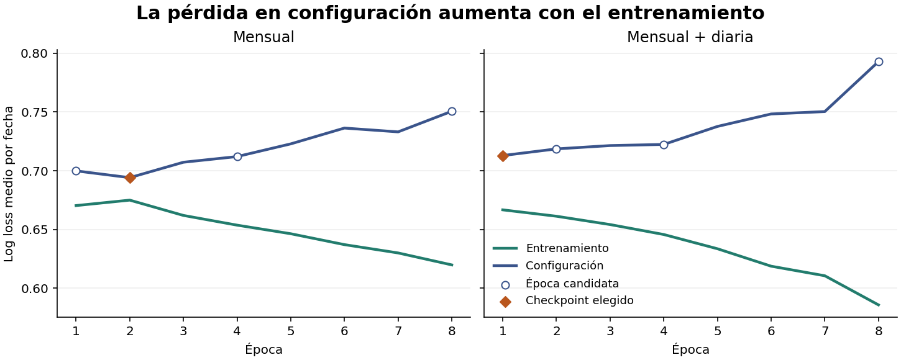
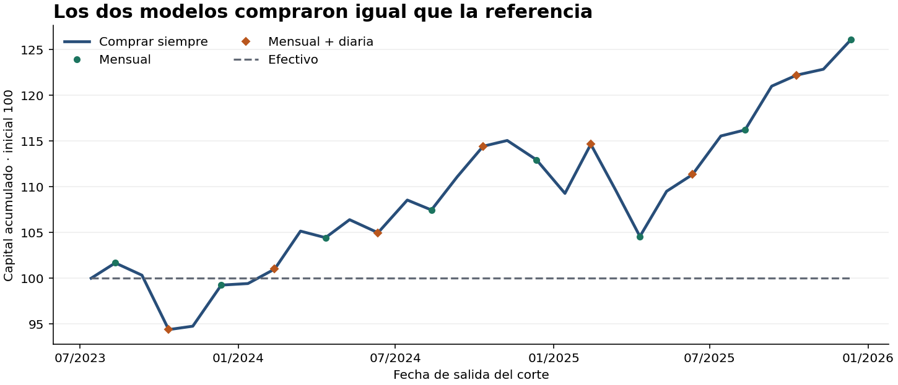

# Iteración 2 · Comprar o mantener efectivo

¿Agregar nueve velas diarias a una CNN de seis velas mensuales mejora el retorno neto de toda la cartera? Lucas lleva adelante esta iteración. El diseño fija una evaluación retrospectiva de cuatro cortes de 2026 y deja la confirmación para un período futuro.

**[Informe académico en Word](informe/Informe_academico.docx?raw=true)** · [Leer el informe completo en GitHub](informe/informe_final.md) · [Guía breve para la defensa oral](informe/guia_oral.md)

Para recorrer la evidencia en GitHub, abrí el [caso de KO con sus dos imágenes](informe/evaluacion_2026.md#caso-ko), la [tabla de las cuatro estrategias por fecha](informe/evaluacion_2026.md#las-cuatro-decisiones-mensuales) y la [curva de capital](verificacion/etapa_4/capital_acumulado.png).

## Etapa 4 · Evaluación retrospectiva de 2026

En cuatro cortes de julio a octubre de 2026, ambas CNN compraron los 136 casos con el umbral congelado de 0,50. Las dos redes y comprar siempre rindieron **+3,35 % neto**. Efectivo rindió **0,00 %**. Agregar la vista diaria cambió **0 de 136** decisiones.

[Comando de reproducción](informe/reproducir_2026.md#comando-de-reproducción) · [Resumen económico](informe/evaluacion_2026.md#resumen-económico) · [Caso KO, de las imágenes al retorno](informe/evaluacion_2026.md#caso-ko)

## Etapa 3B · Modelos y reglas congelados

**Resultado en el bloque de umbral.** Los dos modelos eligieron `p ≥ 0,50` y compraron los 986 casos de los 29 cortes. Los dos y comprar siempre terminaron en **126,10** desde 100 (**+26,10 % neto**). El efectivo terminó en **100**. La diferencia mensual + diaria menos mensual fue **0,00 puntos porcentuales** en este bloque de selección. Los resultados retrospectivos de 2026 se mantuvieron reservados hasta la Etapa 4.

### De las velas a la probabilidad

Estos son los PNG de **KO al 14/07/2023**, el primer corte elegible del bloque de umbral. La vista mensual cubre enero a junio. La diaria cubre las nueve ruedas que terminan el 14/07. El archivo de la izquierda entra en ambas CNN.

| Seis velas mensuales | Nueve velas diarias |
|:---:|:---:|
|  |  |

El render de 3A calcula `100 × ln(P/P₀)` y conserva los límites y la compresión por frecuencia. El cargador verifica el SHA-256 y devuelve un tensor `uint8`. Dentro de cada rama una capa Keras `Rescaling(1/255)` convierte los canales a `float32` en [0, 1]. Se comprobó la primera convolución con una imagen real y los extremos negro y blanco (0 y 1). El error máximo frente a la división directa fue `5,96e−8`.

La rama mensual conserva el esquema de la CNN semanal de la primera iteración, con dos convoluciones ReLU, reducción espacial, aplanado y una capa densa. La primera convolución usa paso 2 para la entrada de 192 × 192. Los dos modelos usan el mismo PNG, la misma estructura y la misma inicialización mensual. Cada CNN aprende sus propios pesos. La segunda agrega ocho rasgos de la vista diaria, los concatena con los dieciséis mensuales y aplica la sigmoide.

| Capa | Salida de la rama mensual | Salida de la rama diaria |
|---|---:|---:|
| Entrada RGB y escalado | 192 × 192 × 3 | 192 × 192 × 3 |
| Conv 3 × 3, paso 2 | 96 × 96 × 8 | 96 × 96 × 4 |
| Max pooling 1 | 48 × 48 × 8 | 24 × 24 × 4 |
| Conv 3 × 3, paso 1 | 48 × 48 × 16 | 24 × 24 × 8 |
| Max pooling 2 | 24 × 24 × 16 | 8 × 8 × 8 |
| Aplanar | 9.216 | 512 |
| Densa ReLU | 16 | 8 |

La mensual lleva sus 16 rasgos a una salida sigmoide y tiene **148.881 parámetros**. La doble lleva 24 rasgos concatenados a la misma clase de salida y tiene **153.401 parámetros**. En ambos casos se estima la probabilidad de que el retorno neto de comprar sea estrictamente positivo. [Dimensiones y parámetros por capa](verificacion/etapa_3b/entrenamiento.json)

### Aprendizaje y elección de checkpoints

| Bloque | Cortes | IDs elegibles | Etiquetas positivas | Descartes y motivo |
|---|---:|---:|---:|---|
| Entrenamiento 2015–2020 | 65 | 2.210 | 1.320 | 34 con salida en 2021 |
| Configuración 2021–2022 | 17 | 578 | 295 | 204 con historia anterior y 34 con salida en 2023 |
| Umbral 2023–2025 | 29 | 986 | 546 | 204 con historia anterior y 34 con salida en 2026 |
| Retrospectiva 2026 | 4 | 136 | Reservadas | 204 con historia anterior y 34 sin salida en la fuente |

Se reconstruyeron las ruedas y la etiqueta con la apertura ajustada de t+1 y el cierre ajustado de t+20. El retorno neto es `cierre / apertura − 1 − 0,002`. Un retorno neto igual a cero tiene etiqueta 0. Los PNG de los tres bloques de 3B coincidieron ID por ID con los hashes ordenados de 3A. El manifiesto conserva los descartes y sus motivos. [Manifiesto](verificacion/manifiesto.csv) · [Recuentos por motivo](verificacion/casos_por_bloque.csv)



Entre las épocas 1, 2, 4 y 8, el menor log loss medio por fecha en configuración se obtuvo en la **época 2** para la mensual (**0,694152**) y en la **época 1** para dos vistas (**0,712953**). En la época 8 el entrenamiento había mejorado a 0,619901 y 0,585876, mientras configuración empeoró a 0,750617 y 0,792848. Esa divergencia indica sobreajuste. Recargar los pesos elegidos reprodujo exactamente las probabilidades por ID en los tres bloques de 3B.

| Modelo | Log loss configuración | AUC configuración | Log loss umbral | AUC umbral |
|---|---:|---:|---:|---:|
| Mensual | 0,6942 | 0,5469 | 0,6862 | 0,5218 |
| Mensual + diaria | 0,7130 | 0,5296 | 0,6933 | 0,5007 |

El log loss de configuración eligió los pesos. Las métricas predictivas de umbral describen la separación y la calidad de sus probabilidades. La elección de umbral se hizo con el capital final de la cartera. [Historial por época](verificacion/etapa_3b/entrenamiento.json) · [Métricas predictivas](verificacion/etapa_3b/prediccion.json)

### De la probabilidad a la cartera

La regla ejecuta una compra si `p ≥ umbral`. Cada fecha divide el patrimonio entre los 34 elegibles. Si una decisión pasa, su parte queda en efectivo al 0 %. Cada compra descuenta 0,20 % de su parte de capital, una sola vez. Se reinvierte el saldo para el corte siguiente.

| Umbral | Capital final mensual | Operaciones | Capital final mensual + diaria | Operaciones |
|---:|---:|---:|---:|---:|
| 0,00 | 126,10 | 986 | 126,10 | 986 |
| 0,30 | 126,10 | 986 | 126,10 | 986 |
| 0,40 | 126,10 | 986 | 126,10 | 986 |
| **0,50** | **126,10** | **986** | **126,10** | **986** |
| 0,60 | 100,00 | 0 | 112,63 | 423 |
| 0,70 | 100,00 | 0 | 103,76 | 47 |
| 1,01 | 100,00 | 0 | 100,00 | 0 |

Se elige el mayor capital final por unidad inicial redondeado a 12 decimales. Los cuatro primeros candidatos empataron en ambos modelos; se eligió el umbral mayor, **0,50**. En los 986 casos la mensual dio probabilidades entre 0,5065 y 0,5818, y la doble entre 0,5533 y 0,7778. Por eso todas las decisiones a 0,50 fueron compras. Los umbrales elegidos y comprar siempre tuvieron 100 % de exposición media; efectivo tuvo 0 %. [Grilla completa y exposición](verificacion/etapa_3b/seleccion_umbral.csv) · [Resultados por corte](verificacion/etapa_3b/carteras_por_corte.csv)



En el ejemplo de KO, las probabilidades fueron **0,5608** para la mensual y **0,5739** para la doble. Ambas compraron en la apertura del 17/07/2023 y salieron al cierre del 11/08/2023. KO recibió **2,9412** unidades (100/34), obtuvo **+0,4748 %** neto y aportó **+0,0140** unidades al patrimonio. Tras las 34 compras, cada cartera quedó en **101,6739** al terminar el corte. [Operación y efecto en la cartera](verificacion/etapa_3b/operacion_ko.json)

### Alcance y reproducción

La igualdad de carteras en 2023–2025 describe el bloque usado para elegir los umbrales. Las ventanas mensuales de cortes vecinos comparten hasta cinco velas y la selección del universo usó la fuente ajustada con revisión retrospectiva de precios. El primer render de 3A mostró recortes en entradas mensuales de 2026 y motivó introducir la compresión gradual. Sus parámetros se estimaron con entrenamiento. Los cuatro cortes de 2026 constituyen una **evaluación retrospectiva con resultados reservados y con entradas ya inspeccionadas**. [Auditoría del render](informe/generador.md) · [Protocolo](informe/protocolo.md)

[Verificar la recarga y reproducir los umbrales](informe/reproducir_3b.md) · [Configuración congelada, rutas y SHA-256 de los pesos](config/congelado_3b.json) · [Entrenamiento](src/entrenar_3b.py) · [Selector](src/seleccionar_3b.py) · [Simulación de cartera](src/cartera.py)

## Etapa 3A · Generador de imágenes

| Para encontrar | Abrir |
|---|---|
| Ejecutar desde el workspace | [Comando para reproducir](#reproducir-las-imágenes) |
| Implementación | [Generador](src/generar_imagenes.py) · [Render de velas](src/render_velas.py) · [Cargadores](src/cargar_imagenes.py) |
| Escala y procedencia del ajuste | [Parámetros del render](config/render.json) · [Escalas congeladas](config/escalas_imagenes.json) · [2.210 IDs de ajuste](verificacion/imagenes/ids_ajuste.txt) |
| Resultados y límites | [Resumen de verificaciones](informe/generador.md) · [Recuentos y hashes](verificacion/imagenes/controles.json) · [Métricas de recorte y detalle](verificacion/imagenes/metricas.csv) |
| KO al 14 de julio de 2015 | [Figura para clase](verificacion/imagenes/KO_2015-07-14_explicado.png) · [PNG mensual compartido](verificacion/imagenes/KO_2015-07-14_mensual.png) · [PNG diario](verificacion/imagenes/KO_2015-07-14_diaria.png) · [OHLC y log de las 15 velas](verificacion/imagenes/KO_2015-07-14_velas.csv) |

### Reproducir las imágenes

Desde la raíz del repositorio, con el OHLC congelado en la ruta del workspace:

```bash
python3 -m venv .venv
source .venv/bin/activate
python -m pip install -r requirements-imagenes.txt
ohlc_iteracion2='../entregables/02 — Base semanal/OHLC_diario_yf20261114T2019Z.csv'
python src/generar_imagenes.py "$ohlc_iteracion2"
```

El comando reconstruye los controles de fechas, recalcula el ajuste de los 2.210 casos de entrenamiento y lo contrasta con los parámetros congelados. Escribe `data/imagenes/indice.csv`, los 7.820 PNG bajo `data/imagenes/cache/` y la evidencia en `data/imagenes/verificacion/`. `--sin-cache` redibuja el lote completo y `--destino` permite elegir otra carpeta local. Para una ruta distinta del OHLC, pasarla como primer argumento. El SHA-256 esperado figura en [Configuración del experimento](config/experimento.json).

Para repetir también la lectura de los dos PNG de KO con Keras, ejecutar en el mismo entorno:

```bash
python -m pip install 'keras==3.10.0' 'jax[cpu]==0.4.30' 'scipy==1.13.1'
KERAS_BACKEND=jax python src/generar_imagenes.py "$ohlc_iteracion2" --verificar-keras
```

## Diseño de la comparación

1. [Protocolo en lenguaje simple y criterios del generador](informe/protocolo.md)
2. [Gráfico del calendario y las fronteras](verificacion/calendario.png)
3. [Tabla de casos y descartes por bloque](verificacion/casos_por_bloque.csv) · [Detalle por activo y corte](verificacion/manifiesto.csv)
4. [Ejemplo numérico de las cuatro estrategias y recorrido real de KO](informe/ejemplo.md)

### Reproducir el diseño

Desde la raíz del repositorio, con Python, pandas, NumPy y Matplotlib:

```bash
python3 src/verificar_protocolo.py '../entregables/02 — Base semanal/OHLC_diario_yf20261114T2019Z.csv'
```

El comando comprueba la huella del insumo local, reproduce el calendario del EDA, valida fechas, bloques y claves compartidas, y regenera las tablas y el gráfico en `verificacion/`. El manifiesto contiene exclusivamente identificadores, fechas y elegibilidad. [Configuración](config/experimento.json) · [Código](src/verificar_protocolo.py)

## EDA y representación · Desarrollo 2015–2025

| Para encontrar | Abrir |
|---|---|
| Hallazgos, fuentes y decisiones para la etapa de diseño | [Nota de revisión](eda/representacion.md) |
| Qué ve la CNN en cada longitud | [Figura de KO con las ventanas](eda/ventanas_KO.png) |
| Casos, fechas, activos y solapamiento entre cortes | [Cortes elegibles para t+20](eda/cortes_desarrollo.csv) · [Cobertura de ventanas](eda/cobertura_ventanas_desarrollo.csv) · [Intersección por activo y corte](eda/elegibilidad_ventanas_desarrollo.csv) |
| Vistas separadas y más cortes de desarrollo | [Combinaciones sin cruce](eda/combinaciones_ventanas_desarrollo.csv) · [Cadencia mensual](eda/cadencia_mensual_desarrollo.csv) |
| Escalas sobre las mismas velas y modelado estocástico | [KO, baja](eda/escalas_KO.png) · [UNP, media](eda/escalas_UNP.png) · [COP, alta](eda/escalas_COP.png) · [Medidas](eda/medidas_escalas_desarrollo.csv) |
| Tres patrones OHLC y una secuencia exploratoria | [Recuentos](eda/patrones_desarrollo.csv) · [Secuencia](eda/combinacion_patrones_desarrollo.csv) · [Casos reales](eda/ejemplos_combinacion_patrones.csv) |
| Cobertura, volatilidad y resultados por grupo | [Activos](eda/activos_desarrollo.csv) · [Sector](eda/resultados_por_sector_desarrollo.csv) · [Tercil](eda/resultados_por_tercil_desarrollo.csv) · [Cruce](eda/resultados_por_sector_y_tercil_desarrollo.csv) · [Figura sectorial](eda/sectores_y_volatilidad.png) |
| Concentración por fecha en el piloto | [Figura](eda/resultados_por_fecha_desarrollo.png) · [Tabla](eda/resultados_por_fecha_desarrollo.csv) · [Operaciones](eda/operaciones_desarrollo.csv) |
| Procedimiento y código | [EDA](src/eda_desarrollo.py) · [Ventanas](src/ventanas.py) · [Cobertura y patrones](src/analizar_representacion.py) · [Figuras de escalas](src/comparar_escalas.py) |
| Alcance y coordinación | [Diseño](informe/protocolo.md) · [Plan de trabajo](informe/plan_de_trabajo.md) · [Configuración](config/experimento.json) |

La primera comparación usa 6 meses cerrados y una vista separada de 9 ruedas. Para el renderizado inicial se eligió [log relativo a la primera apertura de cada vista](eda/representacion.md#modelado-estocástico-y-escalas).

Los retornos corresponden al piloto de desarrollo. Usan costo total supuesto de 0,20 %, entrada en la apertura ajustada de t+1 y salida al cierre ajustado de t+20.

## Reproducir desde el workspace

Ejecutar desde `iteracion_2` con Python, NumPy, pandas y Matplotlib. Se verificó con Python 3.9.6, NumPy 2.0.2, pandas 2.3.3 y Matplotlib 3.9.4.

```bash
ohlc_iteracion2='../entregables/02 — Base semanal/OHLC_diario_yf20261114T2019Z.csv'
indice_cortes='../02 — Base semanal/BASE_SEMANAL/indice_imagenes.csv'
nota_ohlc='../entregables/02 — Base semanal/Fuente_OHLC_diario_yf20261114T2019Z.md'

shasum -a 256 "$ohlc_iteracion2"
MPLBACKEND=Agg python3 src/eda_desarrollo.py "$ohlc_iteracion2" "$indice_cortes" "$nota_ohlc"
MPLBACKEND=Agg python3 src/comparar_escalas.py "$ohlc_iteracion2"
```

El SHA-256 esperado del OHLC congelado `yf20261114T2019Z` es `7906de97be2145f79434dcb1f0a474d2c01ed1da7cc4a7dad1ce63c35683eb31`. Los tres insumos locales se identifican por ruta y el repositorio versiona los resultados derivados. El EDA toma únicamente activo y fecha de corte del índice anterior. El desarrollo de esta iteración abarca 2015–2025 y requiere que t+20 también caiga en ese bloque. El manifiesto de 2026 se construye con fechas y cobertura.
