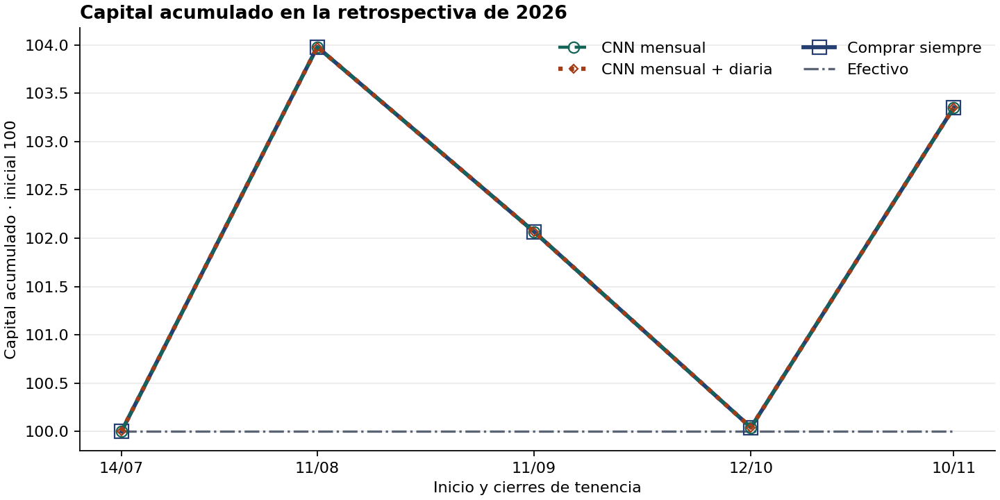
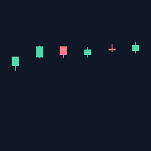
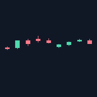

# Etapa 4 · Evaluación retrospectiva de 2026

## Resumen económico

En los cuatro cortes de julio a octubre de 2026, agregar nueve velas diarias a la CNN de seis velas mensuales dejó el retorno neto acumulado **igual en +3,35 %**. A `p ≥ 0,50` las dos redes compraron los 136 casos y reprodujeron la cartera de comprar siempre. El efectivo terminó en 100.

| Estrategia | Retorno neto acumulado | Capital final desde 100 | Operaciones | Exposición media |
|---|---:|---:|---:|---:|
| CNN mensual, época 2 | +3,3511 % | 103,3511 | 136 | 100 % |
| CNN mensual + diaria, época 1 | +3,3511 % | 103,3511 | 136 | 100 % |
| Comprar siempre | +3,3511 % | 103,3511 | 136 | 100 % |
| Efectivo | 0,0000 % | 100,0000 | 0 | 0 % |

Doble menos mensual, mensual menos comprar siempre y doble menos comprar siempre dieron **0,00 puntos porcentuales** cada una. La diferencia fue cero también en cada corte. [Resumen de carteras](../verificacion/etapa_4/carteras_resumen.csv) · [Diferencias exactas](../verificacion/etapa_4/metricas.json)

Las curvas de las dos CNN y comprar siempre se superponen. El primer punto representa el capital inicial al corte del 14/07. Los puntos siguientes corresponden al cierre de la última rueda de cada tenencia. Los segmentos unen esos saldos.

## Las cuatro decisiones mensuales

Cada celda de estrategia muestra **operaciones de compra / retorno neto del corte**. Cada mes tuvo 34 elegibles. La columna de cambios compara las decisiones de las dos CNN por activo.

| Corte | Entrada → salida | CNN mensual | CNN mensual + diaria | Comprar siempre | Efectivo | Cambios |
|---|---|---:|---:|---:|---:|---:|
| 14/07/2026 | 15/07 → 11/08 | 34 / +3,9785 % | 34 / +3,9785 % | 34 / +3,9785 % | 0 / 0,0000 % | 0 |
| 13/08/2026 | 14/08 → 11/09 | 34 / −1,8394 % | 34 / −1,8394 % | 34 / −1,8394 % | 0 / 0,0000 % | 0 |
| 14/09/2026 | 15/09 → 12/10 | 34 / −1,9846 % | 34 / −1,9846 % | 34 / −1,9846 % | 0 / 0,0000 % | 0 |
| 13/10/2026 | 14/10 → 10/11 | 34 / +3,3095 % | 34 / +3,3095 % | 34 / +3,3095 % | 0 / 0,0000 % | 0 |

En cada corte se dividió el capital por 34. Cada compra entró a la apertura ajustada de t+1 y salió al cierre ajustado de t+20. Se descontó una vez el 0,20 % del capital asignado a la compra. Las asignaciones que pasaron quedaron en efectivo a tasa cero. Los saldos se reinvirtieron en el corte siguiente. [Protocolo](protocolo.md#cómo-se-calcula-la-cartera) · [Capital inicial y final, inversión, efectivo y exposición por estrategia y fecha](../verificacion/etapa_4/carteras_por_corte.csv)

Coincidieron **136 de 136** decisiones, todas compras. Las probabilidades difirieron en los 136 IDs y quedaron por encima de 0,50 en ambas redes. El rango fue 0,5114 a 0,5846 en la mensual y 0,5560 a 0,7605 en la doble. Hubo cero asignaciones distintas y su aporte a la diferencia acumulada fue **0,00 puntos porcentuales**. [Conteos y diferencias por corte](../verificacion/etapa_4/decisiones_por_corte.csv) · [Probabilidades, decisiones, retornos y aportes por ID](../verificacion/etapa_4/decisiones_por_id.csv)

## Predicción

La etiqueta vale 1 cuando el retorno de comprar, descontado el costo, es estrictamente positivo. Hubo 69 positivos entre 136 casos (50,74 %). El log loss se promedió dentro de cada fecha y luego entre las cuatro fechas. Brier y AUC ROC se calcularon sobre los 136 casos.

| Modelo | Log loss medio por fecha ↓ | Brier ↓ | AUC ROC ↑ | Probabilidad media |
|---|---:|---:|---:|---:|
| Mensual | 0,6964 | 0,2516 | 0,5224 | 0,5476 |
| Mensual + diaria | 0,7254 | 0,2651 | 0,4203 | 0,6008 |

Las tres métricas predictivas favorecieron a la mensual en este bloque. Las probabilidades distintas produjeron la misma cartera al aplicar el umbral congelado. [Métricas sin redondear](../verificacion/etapa_4/metricas.json)

## Caso KO

**KO al cierre del 14/07/2026.** La imagen mensual usa los seis meses completos de enero a junio, con ruedas fuente del 02/01 al 30/06. La diaria usa las nueve ruedas del 01/07 al 14/07. Los dos archivos son los PNG de entrada de la corrida. Ambas CNN recibieron el mismo PNG mensual.

| Mensual · seis velas | Diaria · nueve velas |
|:---:|:---:|
|  |  |

La CNN mensual estimó **0,529126** y la doble **0,594002**. Ambas superaron 0,50 y compraron. La apertura ajustada del 15/07 fue **82,438078** y el cierre ajustado del 11/08 fue **85,967026**. El retorno bruto fue **+4,2807 %** y, al restar 0,20 puntos porcentuales de costo, la compra rindió **+4,0807 % neto**, con etiqueta 1.

KO recibió **2,941176** unidades de las 100 iniciales y aportó **+0,120021** unidades al saldo de cada cartera que compró. El efectivo aportó cero. Tras las 34 compras, las tres carteras con operaciones cerraron el corte en **103,978497**. [Fechas, precios, decisiones y SHA-256 de ambas imágenes](../verificacion/etapa_4/caso_ko.json)

## Alcance

Esta es una **evaluación retrospectiva con resultados reservados hasta esta ejecución**. El alcance temporal son cuatro fechas, del corte del 14/07 al del 13/10 de 2026, con última salida el 10/11. La conclusión económica se limita a esos cortes, esos activos y la regla congelada.

El universo de 34 activos se seleccionó retrospectivamente de 42 series a partir de la revisión de cobertura, precios y ajustes del historial hasta noviembre de 2026. Entre los cortes vecinos, las ventanas mensuales de un mismo activo comparten cinco de las seis velas. Entre julio y octubre comparten tres. Las 136 filas representan decisiones relacionadas dentro de cuatro fechas. [Protocolo y revisión previa de la fuente](protocolo.md#qué-se-había-visto) · [Historia compartida](../verificacion/historia_compartida.csv)

En 3A se inspeccionaron las entradas de 2026. El render lineal inicial saturaba el 5,27 % de las velas mensuales de ese bloque y esa observación motivó pasar a la compresión gradual. Los parámetros finales se estimaron con entrenamiento. Las etiquetas, predicciones y carteras de los cuatro cortes de esta iteración se abrieron con el evaluador fijado para la Etapa 4. [Auditoría del render](generador.md) · [Reproducción y huellas](reproducir_2026.md)
