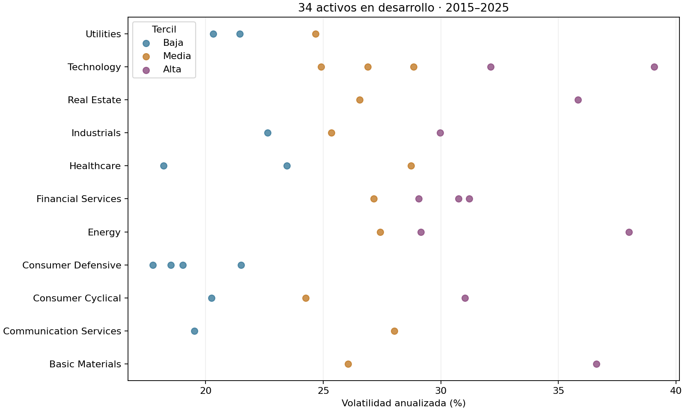
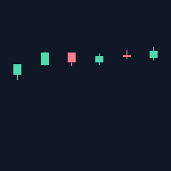
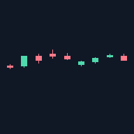

# ¿Mejora la cartera al sumar nueve velas diarias a seis mensuales?

**Trabajo Final de Ciencia de Datos 1 · Lucas Caronni · Segunda iteración**

En cuatro cortes de 2026, agregar la vista diaria cambió las probabilidades de las 136 oportunidades y dejó intactas las 136 decisiones de compra. Desde 100 unidades, la CNN mensual, la CNN de dos vistas y comprar siempre terminaron en **103,3511**. Mantener efectivo terminó en **100**. El aporte de la vista diaria al retorno neto acumulado fue **0,0000 puntos porcentuales** con la regla congelada. ¿Cómo pueden dos redes que estiman probabilidades distintas producir exactamente la misma cartera? El recorrido de KO permite seguir la respuesta desde los precios hasta el saldo. [Guía para la defensa](guia_oral.md) · [Tabla de resultados](../verificacion/etapa_4/carteras_resumen.csv)

## 1. De una pregunta predictiva a una decisión de inversión

Gabriel propuso en clase comparar una vista de contexto con otra más reciente. En la primera iteración, la pregunta fue si agregar diez ruedas diarias a trece velas semanales ayudaba a anticipar una suba del cierre ajustado de al menos 5 % en las veinte ruedas siguientes, especialmente cuando el movimiento reciente iba en sentido opuesto al semanal. La etiqueta miraba hacia adelante. Las dos imágenes terminaban en el corte y compartían parte de su historia. [Consigna oral](https://drive.google.com/file/d/1Uq_jN8NQ2zf-Wq4z615iWWaCTyrZ2mPH/view) · [Protocolo y antecedentes del proyecto](protocolo.md#qué-se-había-visto)

Tres trabajos orientaron esa comparación. Hung y Chen (2021) estudiaron cómo extraer información de gráficos de velas para predecir movimientos de precios. Brim y Flann (2022) examinaron las regiones de las imágenes que activaba una CNN en una estrategia de aprendizaje por refuerzo. Chen y Tsai (2022) estudiaron cómo localizar patrones de velas mediante una codificación de series temporales. Estos trabajos motivaron estudiar la geometría de las velas y la información reciente. La pregunta sobre el aporte de una segunda vista a esta cartera y la forma de medirlo corresponden a este experimento. [Hung y Chen, *DPP: Deep predictor for price movement from candlestick charts*](https://doi.org/10.1371/journal.pone.0252404) · [Brim y Flann, *Deep reinforcement learning stock market trading, utilizing a CNN with candlestick images*](https://doi.org/10.1371/journal.pone.0263181) · [Chen y Tsai, *Dynamic Deep Convolutional Candlestick Learner*](https://arxiv.org/abs/2201.08669)

En los 204 casos de validación de la primera iteración, 45 alcanzaron el +5 %. La pérdida logarítmica, que penaliza más los errores cometidos con alta confianza, bajó de **0,559367** con una probabilidad constante a **0,548292** con la semanal y **0,537379** con dos vistas. Aun así, con umbral 0,50 la semanal señaló un solo positivo y la doble, ninguno. La mejora relativa fue mayor en el grupo de movimientos opuestos en apenas tres de seis fechas. La validación sirvió también para elegir la época. Estos datos dejaron abierta la utilidad práctica de la mejora predictiva. [Diagnóstico de validación](https://drive.google.com/file/d/1hrYiTiVHOW3BKFMo4RZeArCsBNh_Oq-g/view) · [Resultados por grupo](https://drive.google.com/file/d/1Sm2OamdxQLwkcnoIIj7AXZr6sMlKxuZP/view)

En la segunda iteración cambié la pregunta. Al cierre de un corte mensual, ¿agregar nueve ruedas recientes a seis meses cerrados mejora el retorno neto de una estrategia que decide qué partes de la cartera invertir y cuáles guardar en efectivo? Para responder, comparé las redes sobre los mismos activos, fechas y precios de ejecución. La etiqueta pasó a ser **compra con retorno neto estrictamente positivo**. La medida principal pasó a ser el retorno acumulado de la doble menos el de la mensual, en puntos porcentuales. Comprar siempre permite identificar cuánto se habría ganado por tomar toda la exposición disponible. [Protocolo](protocolo.md)

## 2. Qué datos entraron y qué decidió el análisis exploratorio

Reutilicé el archivo de precios que Simon documentó para la primera iteración. La fuente es una descarga congelada de Yahoo Finance mediante `yfinance`, versión de datos `yf20261114T2019Z`. Cada fila contiene activo, fecha y cuatro precios diarios (OHLC, por las iniciales en inglés de apertura, máximo, mínimo y cierre). Se aplicó el mismo factor de ajuste a los cuatro precios para incorporar splits y dividendos de manera consistente. El archivo abarca del 02/01/2015 al 13/11/2026. En las 42 series candidatas se cotejaron las 2.985 sesiones con el calendario de Nueva York, los duplicados y faltantes, los precios positivos y la coherencia de máximos y mínimos. Se excluyeron ocho activos con escisiones registradas como splits fraccionarios cuyo factor carecía de verificación independiente. Así quedaron **34 activos de 11 sectores**. El criterio usó el historial completo, incluidos eventos de 2026. La documentación permite reconstruir el paso de 42 candidatas a 34 incluidas. El marco de muestreo que dio origen a las 42 queda sin documentar en la nota de fuente. [Nota original de fuente y exclusiones](https://drive.google.com/file/d/1y1QvfkneeCiFSnn6tMzzYFTCgpWjFHlQ/view) · [Activos, sectores y cobertura](../eda/activos_desarrollo.csv)

**Qué mostró el piloto.** Sobre el calendario heredado, con datos de desarrollo hasta 2025, hubo 38 fechas y 1.292 compras simuladas. Con el costo supuesto del estudio, 804 dieron retorno neto positivo (62,2 %) y la media por operación fue +2,51 %. Importó cuándo se compraba. En el corte del 20/03/2020 los 34 activos ganaron y el retorno medio fue +26,41 %. Esa concentración motivó presentar los resultados finales fecha por fecha. [Operaciones del piloto](../eda/operaciones_desarrollo.csv) · [Resultados por fecha](../eda/resultados_por_fecha_desarrollo.csv)

En tecnología resultaron positivas 131 de 190 compras (68,9 %) y en energía, 62 de 114 (54,4 %). Al ordenar los activos por volatilidad histórica —desvío de los retornos diarios de desarrollo, anualizado con la raíz de 252—, los terciles bajo, medio y alto reunieron 11, 12 y 11 activos. Sus proporciones positivas fueron **58,1 %, 67,3 % y 60,8 %**. El grupo intermedio tuvo la proporción más alta. Todo consumo defensivo quedó en el tercil bajo y diez de las 33 combinaciones sector × tercil estaban vacías. La composición de la muestra limita atribuir las diferencias al sector o a la volatilidad por separado. [Sectores](../eda/resultados_por_sector_desarrollo.csv) · [Terciles](../eda/resultados_por_tercil_desarrollo.csv) · [Cruce](../eda/resultados_por_sector_y_tercil_desarrollo.csv)

**Por qué seis meses y nueve ruedas.** En el calendario heredado, tres, seis, nueve y doce meses combinados con nueve ruedas diarias separadas dejaban respectivamente 1.292, 1.258, 1.224 y 1.190 casos. Seis meses ofrecían contexto de medio año y conservaban 37 de las 38 fechas del piloto. Entre las longitudes diarias ensayadas, nueve era la mayor que mantenía los 1.258 casos sin repetir una rueda del tramo mensual. Con diez se repetía una sesión en 68 casos y con veinte había cruce en todos. Fue una decisión de cobertura y separación temporal. El EDA también contó ejemplos de patrones con definiciones inspiradas en Ponsi. La secuencia de doji mensual y envolvente alcista diaria apareció en solo dos de esos 1.258 casos. Las CNN recibieron las velas y la etiqueta de resultado económico, sin etiquetas de patrones. [Combinaciones ensayadas](../eda/combinaciones_ventanas_desarrollo.csv) · [Figura de ventanas](../eda/ventanas_KO.png) · [Nota del EDA, Ponsi y recuentos](../eda/representacion.md#patrones-ohlc)

**Qué se supuso para simular.** Se partió de 100 unidades. En cada corte, cada activo recibió 1/34 del capital disponible. La decisión se tomó al cierre de la rueda t. Cada compra entró a la apertura ajustada de t+1 y salió al cierre ajustado de t+20. A su rendimiento se le restaron **0,20 puntos porcentuales una sola vez**, un costo total supuesto por operación. La parte que quedó en efectivo rindió 0 % y conservó su asignación. El saldo completo se reinvirtió en el corte siguiente. Son hipótesis de ejecución y costos. Los precios son observaciones históricas ajustadas. [Reglas de cartera](protocolo.md#cómo-se-calcula-la-cartera) · [Configuración económica](../config/evaluacion_2026.json)

## 3. Qué aprendió la computadora

### Cuatro bloques con funciones distintas

Con la cadencia mensual, se eligió el primer cierre factible de cada mes que ya tuviera nueve ruedas de ese mes y estuviera a por lo menos veinte ruedas del corte anterior. Todos los activos de la fecha se asignaron al mismo bloque. El manifiesto exigió que tanto la historia de las dos vistas como la tenencia completa quedaran dentro de sus fronteras. Las posiciones anteriores ya habían salido al abrir las siguientes. [Calendario](../verificacion/calendario.png) · [Manifiesto](../verificacion/manifiesto.csv)

| Bloque | Cortes | Casos | Qué se hizo con ellos |
|---|---:|---:|---|
| Entrenamiento 2015–2020 | 65 | 2.210 | Ajustar las escalas de dibujo y aprender los pesos de cada CNN. |
| Configuración 2021–2022 | 17 | 578 | Elegir, para cada red, los pesos guardados de la época con menor pérdida logarítmica media por fecha. |
| Umbral 2023–2025 | 29 | 986 | Simular la misma grilla de umbrales en cada red y elegir por capital final. |
| Evaluación retrospectiva 2026 | 4 | 136 | Aplicar pesos y reglas congelados y comparar las cuatro estrategias. |

Por ejemplo, de 2026 quedaron fuera enero a junio porque sus imágenes mensuales necesitaban precios de 2025. Noviembre quedó fuera porque la serie terminaba antes de la salida a veinte ruedas. El generador comprobó para los **3.910 casos elegibles** el orden de los identificadores y la igualdad del PNG mensual que recibían ambos modelos. Se contrastaron las huellas SHA-256 de los 7.820 PNG. En controles sobre KO, modificar los precios posteriores al corte o truncar la serie en el corte dejó iguales las dos imágenes. Al recargar los pesos elegidos se reprodujeron con error máximo cero las probabilidades guardadas de los tres primeros bloques. [Descartes por bloque](../verificacion/casos_por_bloque.csv) · [Controles del generador](generador.md) · [Control de la evaluación](../verificacion/etapa_4/control.json)

### Un caso real desde el precio hasta los dos PNG

Al cierre del **14/07/2026**, la mensual de Coca-Cola (KO) resumía enero a junio. Cada mes aportó su primera apertura, el máximo de sus máximos, el mínimo de sus mínimos y su último cierre. Por ejemplo, enero abrió en **68,519111**, alcanzó **73,472894**, tuvo mínimo **65,988268** y cerró en **73,384605** USD ajustados. La vista diaria conservó una vela por rueda del 01/07 al 14/07. El cuerpo une apertura y cierre, el color distingue la dirección y la mecha llega hasta el máximo y el mínimo. [Fuente y huella del OHLC](reproducir_2026.md#insumos-locales-y-huellas) · [Ficha de KO](../verificacion/etapa_4/caso_ko.json)

| Seis meses cerrados · entrada de ambas redes | Nueve ruedas recientes · entrada adicional |
|:---:|:---:|
|  |  |

Para dibujar cada precio se calculó **z = 100 × ln(P/P₀)**. P₀ es la primera apertura de *esa* vista. Cada gráfico empieza así con apertura en cero, y dos movimientos de igual razón de precios tienen igual distancia logarítmica. En la diaria de KO, P₀ fue 81,215372 y el último cierre fue 82,587196, de modo que su coordenada fue **+1,6750**. Usar una referencia propia permite comparar movimientos entre activos con precios en dólares muy distintos. El EDA contrastó esta elección con min–max, que expande tanto una ventana tranquila como una volátil hasta ocupar todo el rango. [Comparación de escalas y fundamentos](../eda/representacion.md#modelado-estocástico-y-escalas) · [Ejemplo de escalas en KO](../eda/escalas_KO.png)

El eje vertical se fijó por frecuencia con los 2.210 ejemplos de entrenamiento. Entre los percentiles 0,5 de los mínimos y 99,5 de los máximos, una unidad de z ocupa 1,557 píxeles en la mensual y 4,803 en la diaria. Fuera de ese tramo, los extremos se comprimen gradualmente en 12 filas por lado. Esto conserva el orden de los precios y deja más detalle en el centro, aunque una mecha pequeña puede quedar en la misma fila que el cuerpo. Una vez dibujado el PNG RGB de 192 × 192, Keras aplica **Rescaling(1/255)** a cada canal antes de la primera convolución. En ese paso una intensidad de 255 se convierte en 1 y una de 0 queda en 0. El logaritmo actúa sobre precios. La división por 255 actúa sobre colores. [Escalas congeladas](../config/escalas_imagenes.json) · [Render y verificación de resolución](generador.md) · [Capa de Keras](https://keras.io/api/layers/preprocessing_layers/image_preprocessing/rescaling/)

El EDA tomó el movimiento browniano geométrico como referencia para expresar cambios proporcionales y el trabajo de Engle sobre volatilidad condicional para considerar que la amplitud cambia con el tiempo. En el experimento estas ideas orientaron el dibujo de las velas. La CNN aprendió directamente de las imágenes. [Kempthorne, *Stochastic Calculus*, MIT (2024)](https://ocw.mit.edu/courses/18-642-topics-in-mathematics-with-applications-in-finance-fall-2024/mit18_642_f24_lec19_1.pdf) · [Engle, ARCH (1982)](https://doi.org/10.2307/1912773)

### Del dibujo a la probabilidad

| Operación | Rama mensual | Rama diaria |
|---|---:|---:|
| Entrada RGB y escalado de canales | 192 × 192 × 3 | 192 × 192 × 3 |
| Convolución 3 × 3, paso 2, ReLU | 96 × 96 × 8 | 96 × 96 × 4 |
| Max pooling | 2 × 2 → 48 × 48 × 8 | 4 × 4 → 24 × 24 × 4 |
| Convolución 3 × 3, paso 1, ReLU | 48 × 48 × 16 | 24 × 24 × 8 |
| Max pooling | 2 × 2 → 24 × 24 × 16 | 3 × 3 → 8 × 8 × 8 |
| Aplanado → capa densa ReLU | 9.216 → 16 rasgos | 512 → 8 rasgos |

Los filtros aprenden combinaciones locales de píxeles. El *max pooling* conserva la activación máxima de cada región y reduce el tamaño del mapa. En la **CNN mensual**, los 16 rasgos pasan a una neurona sigmoide (148.881 parámetros en total). En la **CNN mensual + diaria**, la fusión ocurre después de las dos capas densas. Se concatenan los 16 rasgos mensuales con los 8 diarios, y una sigmoide recibe los 24 (153.401 parámetros). La rama mensual empezó con idéntica arquitectura e inicialización en ambas redes. Cada modelo ajustó después sus propios pesos. [Código de ambas redes](../src/cnn_modelos.py) · [Dimensiones registradas](../verificacion/etapa_3b/entrenamiento.json)

La etiqueta de entrenamiento valía 1 si `cierre(t+20) / apertura(t+1) − 1 − 0,002 > 0`, y 0 en los demás casos. Para cada lote, la red comparó su salida entre 0 y 1 con esas etiquetas mediante entropía cruzada binaria. Cuando una compra histórica había ganado, asignarle poca probabilidad aumentaba la pérdida. Cuando había perdido, asignarle mucha también la aumentaba. Adam actualizó los pesos para reducir esa pérdida. Así se obtiene una **probabilidad estimada de terminar en positivo**. La etiqueta solo indica el signo del resultado, así que la salida por sí sola tampoco indica cuánto capital se ganaría o perdería. [Configuración de entrenamiento](../config/entrenamiento_cnn.json)

Entre las épocas 1, 2, 4 y 8, configuración eligió la **época 2** para la mensual (log loss 0,694152) y la **época 1** para la doble (0,712953). Seguir hasta la época 8 redujo la pérdida de entrenamiento y empeoró la de configuración en ambas redes, señal de sobreajuste. Después, ya con esos pesos fijos, en el bloque de umbral se probaron 0,00, 0,30, 0,40, 0,50, 0,60, 0,70 y 1,01. Para ambas CNN los cuatro primeros empataron en el máximo capital final, 126,0975 desde 100. El desempate previsto eligió **0,50**, el mayor de esos umbrales. Desde entonces la regla fue comprar si **p ≥ 0,50**. [Curvas de aprendizaje](../verificacion/etapa_3b/curvas_entrenamiento.png) · [Tabla de selección](../verificacion/etapa_3b/seleccion_umbral.csv) · [Pesos y reglas congelados](../config/congelado_3b.json)

**Vuelta a KO.** La mensual estimó **0,529126** y la doble **0,594002**. Ambas compraron. La entrada del 15/07 se ejecutó a **82,438078** y la salida del 11/08 a **85,967026**. El retorno bruto fue +4,2807 %. Al descontar el costo quedó **+4,0807 % neto**, etiqueta 1. Como era el primer corte, KO recibió 100/34 = 2,941176 unidades y aportó **+0,120021 unidades** de ganancia. Las 34 operaciones juntas llevaron la cartera a **103,978497**. [Precios, decisiones y aporte de KO](../verificacion/etapa_4/caso_ko.json) · [Otras 33 compras del corte y resto de los casos](../verificacion/etapa_4/decisiones_por_id.csv)

## 4. Qué pasó con el capital

Cada columna muestra el retorno neto sobre todo el capital de la estrategia. La última fila compone los cuatro rendimientos reinvirtiendo el saldo disponible. Las fechas de entrada y salida corresponden a la tenencia de las estrategias que compraron. [Detalle por estrategia y corte](../verificacion/etapa_4/carteras_por_corte.csv)

| Corte de 2026 | Entrada → salida | CNN mensual | CNN mensual + diaria | Comprar siempre | Efectivo |
|---|---|---:|---:|---:|---:|
| 14/07 | 15/07 → 11/08 | +3,9785 % | +3,9785 % | +3,9785 % | 0,0000 % |
| 13/08 | 14/08 → 11/09 | −1,8394 % | −1,8394 % | −1,8394 % | 0,0000 % |
| 14/09 | 15/09 → 12/10 | −1,9846 % | −1,9846 % | −1,9846 % | 0,0000 % |
| 13/10 | 14/10 → 10/11 | +3,3095 % | +3,3095 % | +3,3095 % | 0,0000 % |
| **Acumulado** | **100 iniciales** | **+3,3511 %** | **+3,3511 %** | **+3,3511 %** | **0,0000 %** |

Las tres trayectorias invertidas se superponen incluso en los dos cortes con pérdidas. En cada fecha compraron los 34 activos con peso 1/34. La probabilidad mensual estuvo entre **0,5114 y 0,5846** y la doble entre **0,5560 y 0,7605**. Hasta la estimación más baja de cada modelo superó el umbral. Como una probabilidad más alta tampoco aumentaba el tamaño de la compra, hubo **100 % de exposición y cero cambios de asignación**. El efectivo tuvo exposición cero en las cuatro fechas. [Decisiones por corte](../verificacion/etapa_4/decisiones_por_corte.csv) · [Resumen de capital y exposición](../verificacion/etapa_4/carteras_resumen.csv)

**¿Eran igual de buenas las probabilidades?** Hubo 69 compras positivas entre 136. La mensual obtuvo mejor pérdida logarítmica media por fecha (0,6964 frente a 0,7254), menor error cuadrático de probabilidad o Brier (0,2516 frente a 0,2651) y mayor AUC (0,5224 frente a 0,4203). El AUC resume la capacidad de ordenar a los positivos por encima de los negativos. Estas diferencias describen las probabilidades en la muestra. La regla de cartera trató por igual a todos los casos por encima del umbral. [Métricas completas](../verificacion/etapa_4/metricas.json)

## Conclusión y alcance

**Para estos 34 activos, estas cuatro fechas y la regla congelada, agregar nueve velas diarias no mejoró el retorno neto.** La diferencia fue cero tanto frente a la mensual como frente a comprar siempre. El +3,3511 % corresponde a haber tenido la misma exposición que esa referencia. Los dos cortes negativos muestran el costo de oportunidad de que ninguna CNN eligiera efectivo. [Evaluación cerrada](evaluacion_2026.md)

La unidad temporal importa. Los 34 activos de una fecha atravesaron el mismo entorno de mercado. En cortes mensuales consecutivos de un mismo activo se repiten cinco de las seis velas de contexto. Incluso julio y octubre comparten tres. Dentro de cada ejemplo la vista diaria sí está separada de la mensual y las tenencias sucesivas liberan el capital antes de la siguiente entrada. Las 136 decisiones, por tanto, corresponden a **cuatro fechas relacionadas**, con poca base para extrapolar a otros períodos. La selección retrospectiva de los activos y el uso de precios ajustados con el historial completo limitan también la extrapolación a un universo elegible en tiempo real. [Historia compartida entre cortes](../verificacion/historia_compartida.csv) · [Auditoría temporal](protocolo.md)

La reserva de 2026 alcanzó a las etiquetas, predicciones y resultados económicos de esta comparación. **Las imágenes de 2026 ya se habían inspeccionado**. El render inicial saturaba el 5,27 % de las velas mensuales del bloque y esa observación motivó adoptar compresión gradual. Sus parámetros finales se estimaron en entrenamiento. Por eso la evaluación documenta un resultado retrospectivo con decisiones congeladas y entradas previamente vistas. [Auditoría del generador](generador.md) · [Congelamiento y reproducción](reproducir_2026.md)

**Trabajo futuro.** Para saber si la conclusión se sostiene, el siguiente contraste sería fijar de antemano el universo con información disponible en cada fecha, la regla, los costos y la duración de un período nuevo, y reservar también sus imágenes. Más fechas permitirían estudiar la variación temporal de la diferencia de cartera. En desarrollo se podría comparar una CNN de menor capacidad frente al sobreajuste observado, y evaluar la calibración y una regla que tenga en cuenta la magnitud de ganancias y pérdidas. Cada alternativa requeriría seleccionarse en desarrollo y congelarse antes de evaluarla en datos nuevos.
