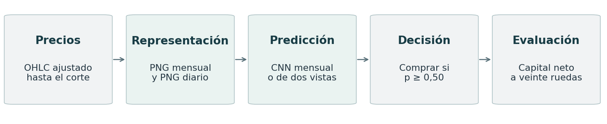
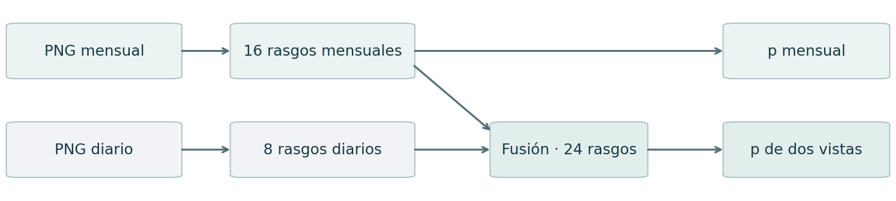
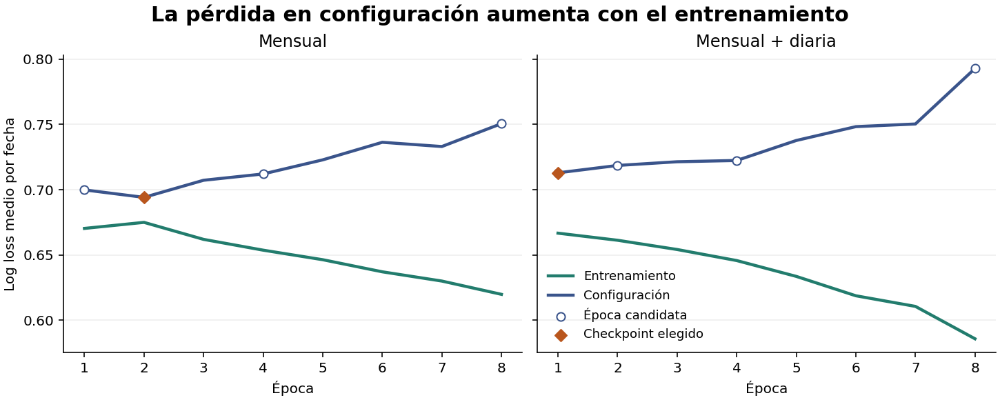
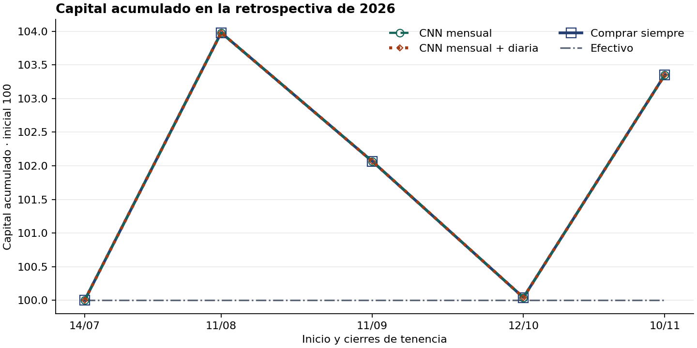
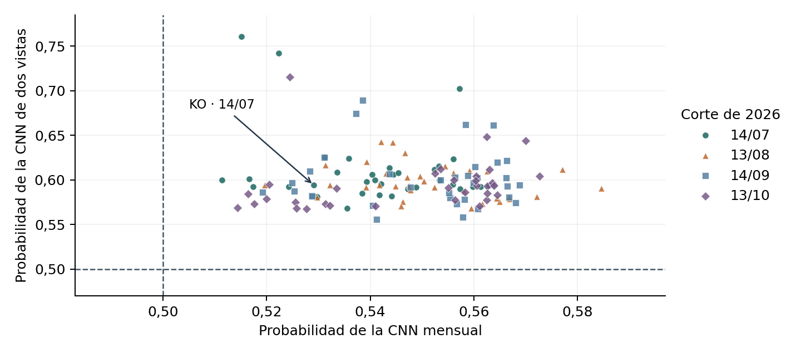

# ¿Cuánto aporta la vista diaria a una estrategia de compra?

Trabajo Final de Ciencia de Datos 1 · Lucas Caronni · Noviembre de 2026

### Resumen

El proyecto estudia una decisión que se repite cada mes. Una persona puede invertir una fracción de su capital en una acción durante veinte ruedas o conservar esa fracción en efectivo. Al tomar la decisión dispone del historial de precios. ¿Le sirve distinguir lo ocurrido en los últimos días, además de conocer la trayectoria de los meses anteriores? Para responder, comparé dos redes neuronales convolucionales (CNN). Una recibió una imagen de seis velas mensuales. La otra recibió esa misma imagen y un segundo gráfico con nueve velas diarias recientes. Cada red estimó la probabilidad de que comprar produjera un retorno neto positivo. Una regla fijada en desarrollo convirtió la estimación en una orden de compra o en una asignación a efectivo.

La evaluación retrospectiva abarcó 34 acciones y cuatro cortes entre julio y octubre de 2026. La información diaria modificó las 136 estimaciones. En ambas redes, todas superaron el umbral de 0,50 y activaron compras del mismo tamaño. Con un costo supuesto de ida y vuelta del 0,20 %, las dos carteras y la estrategia de comprar siempre rindieron **+3,3511 % neto acumulado**. La diferencia atribuible a usar la segunda estrategia fue **0,0000 puntos porcentuales** en este período. El diseño permite explicar el empate operación por operación. Su alcance está condicionado por la selección retrospectiva del universo, la historia compartida entre cortes y la revisión de las imágenes de 2026 durante el desarrollo del generador.

### Pregunta de investigación y criterio de respuesta

**¿Agregar nueve velas diarias a una CNN que observa seis velas mensuales mejora el retorno neto de una cartera simulada que decide cuándo comprar y cuándo mantener el capital en efectivo?**

La hipótesis económica es concreta. Si la vista diaria ayuda a evitar compras que terminan en pérdida, o a conservar compras que terminan en ganancia, la cartera de dos vistas podría terminar con más capital que la mensual. Para detectar ese aporte, comparé el retorno acumulado de ambas carteras en las mismas oportunidades. Un valor positivo de la diferencia favorece a la CNN de dos vistas. Una predicción distinta solo puede afectar el saldo si modifica una asignación. Esta condición vincula la representación de los precios con el aprendizaje supervisado y la simulación de cartera.



*Esquema del experimento. El corte de decisión separa la información observada de los precios futuros de ejecución. Fuente: elaboración propia a partir del protocolo.*

## 1. Antecedentes y reformulación del problema

La propuesta oral de Gabriel fue comparar una vista amplia de contexto con una vista reciente. Una vela resume la diferencia entre la apertura y el cierre y los extremos alcanzados en un intervalo. Al resumir un mes, sin embargo, se pierde el orden de los movimientos dentro de ese mes. Dos trayectorias pueden abrir, cerrar y alcanzar los mismos extremos en secuencias muy distintas. Esa pérdida de detalle ofrece una razón para estudiar dos escalas temporales. El proyecto debía precisar cuánto pasado se observa, qué acontecimiento se predice y cómo se decide si la información adicional resulta útil. [Consigna oral de Gabriel](https://drive.google.com/file/d/1Uq_jN8NQ2zf-Wq4z615iWWaCTyrZ2mPH/view)

Hung y Chen (2021) estudiaron la predicción de movimientos a partir de representaciones aprendidas de gráficos de velas. Brim y Flann (2022) incorporaron imágenes a una estrategia de aprendizaje por refuerzo y examinaron qué regiones del gráfico activaban su red. Chen y Tsai (2022) investigaron la clasificación y localización de patrones mediante una codificación de series temporales. Estos antecedentes justifican que una imagen pueda contener geometría aprovechable. Dejan abierta la pregunta específica de este trabajo sobre cómo cambia una cartera cuando se agrega una segunda vista.

### Qué enseñó la comparación semanal

En la primera iteración se compararon trece velas semanales con esas mismas trece velas más las últimas diez ruedas diarias. Se buscaba anticipar si el cierre ajustado subiría al menos 5 % en veinte ruedas, con especial interés en los casos donde el movimiento semanal y el diario tenían sentidos opuestos. Hubo 1.428 ejemplos de 34 activos. Se reservaron 1.020 para desarrollo, 204 para validación y 204 para prueba. Los resultados que motivaron la reformulación proceden de la validación en seis fechas. [Diagnóstico de la primera iteración](https://drive.google.com/file/d/1hrYiTiVHOW3BKFMo4RZeArCsBNh_Oq-g/view)

| Modelo en validación | Pérdida logarítmica | Positivos señalados a 0,50 | Positivos reales |
|---|---:|---:|---:|
| Probabilidad constante de desarrollo | 0,559367 | 0 | 45 de 204 |
| CNN semanal | 0,548292 | 1 | 45 de 204 |
| CNN semanal + diaria | 0,537379 | 0 | 45 de 204 |

La doble obtuvo la menor pérdida logarítmica. Asignó en promedio probabilidades más cercanas a la frecuencia observada de positivos, aunque nunca cruzó 0,50. Con ese umbral, acertar los 159 negativos ya daba 77,94 % de exactitud. La ventaja relativa de la segunda vista fue mayor en el grupo de movimientos opuestos en solo tres de las seis fechas. Una mejora en la calidad de las probabilidades, por tanto, dejaba abierta su utilidad al tomar decisiones. [Auditoría de resultados por grupo](https://drive.google.com/file/d/1Sm2OamdxQLwkcnoIIj7AXZr6sMlKxuZP/view)

En la segunda iteración cambié juntos el objetivo y su evaluación. El evento de interés pasó a ser que una compra ejecutable cubriera su costo y terminara en positivo. Separé en el calendario el contexto mensual del tramo diario reciente. Finalmente, reservé períodos distintos para aprender los pesos, elegirlos, seleccionar la regla económica y evaluar la cartera. Por eso los dos experimentos responden preguntas diferentes y sus rendimientos y pérdidas requieren interpretaciones propias.

## 2. Datos y decisiones del análisis exploratorio

Reutilicé el archivo de precios documentado por Simon para la primera iteración. La descarga de Yahoo Finance vía yfinance, identificada como yf20261114T2019Z, contiene precios diarios ajustados por splits y dividendos. Se aplicó a apertura, máximo, mínimo y cierre el mismo factor de ajuste. La serie congelada evita que una descarga posterior introduzca revisiones en mitad del experimento. Cada una de las 42 candidatas cubría las 2.985 sesiones del calendario de Nueva York entre el 02/01/2015 y el 13/11/2026. Se controlaron duplicados, faltantes, valores positivos y coherencia entre máximos, mínimos, aperturas y cierres. Ocho candidatas tenían escisiones registradas como splits fraccionarios cuyo factor carecía de contraste independiente. Quedaron 34 acciones de 11 sectores. La fuente documenta la exclusión de las ocho. El marco de selección inicial de las 42 queda indeterminado. [Nota original de fuente](https://drive.google.com/file/d/1y1QvfkneeCiFSnn6tMzzYFTCgpWjFHlQ/view)


*Figura 1. Cada punto ubica una acción según su sector y su volatilidad anualizada. El color indica el tercil de desarrollo. Diez de las 33 combinaciones están vacías. Fuente: EDA del proyecto.*

En el piloto de desarrollo, las 38 fechas del calendario heredado dejaron 1.292 oportunidades. Con el costo supuesto de la estrategia, 804 compras ganaron y el retorno medio por operación fue +2,51 %. La proporción positiva alcanzó 68,9 % en tecnología y 54,4 % en energía. Ordenados por el desvío de sus retornos diarios anualizado, los grupos de volatilidad baja, media y alta tuvieron 58,1 %, 67,3 % y 60,8 % de positivos. El grupo intermedio tuvo la proporción más alta. Todo consumo defensivo quedó en el grupo bajo. La escasa cobertura de algunas celdas de la figura 1 limita cualquier atribución separada al sector o a la volatilidad. [Sectores](../eda/resultados_por_sector_desarrollo.csv) · [Terciles](../eda/resultados_por_tercil_desarrollo.csv)

### Cuánto contexto y cuánto detalle conservar

Con nueve ruedas recientes y sin cruce entre vistas, los contextos de tres, seis, nueve y doce meses dejaban 1.292, 1.258, 1.224 y 1.190 casos en el calendario heredado. Elegí seis meses porque preservaban 37 de las 38 fechas y daban medio año de contexto. Entre las longitudes exploradas, nueve ruedas era la mayor que conservaba los 1.258 ejemplos sin invadir el tramo mensual. Con diez ruedas ya se repetía una sesión en 68 casos y con veinte había cruce en todos. La elección respondió a cobertura y separación temporal. El estudio dejó sin estimar cuál sería la longitud óptima en términos de rentabilidad. [Combinaciones y cruces](../eda/combinaciones_ventanas_desarrollo.csv)

## 3. Diseño temporal y simulación de la cartera

La unidad de observación es el par activo–fecha de corte. Para una decisión al cierre de la rueda t, el programa toma los seis meses calendario completos anteriores y las últimas nueve ruedas hasta t inclusive. Elige el primer cierre factible de cada mes con al menos veinte ruedas desde el corte anterior. La entrada ocurre a la apertura de t+1 y la salida al cierre de t+20. Así, el precio usado para comprar ya es posterior a la decisión y el capital de cada operación se libera antes de la entrada siguiente. Todos los activos de una fecha pertenecen al mismo bloque. [Protocolo temporal](protocolo.md)

### Cuatro bloques con funciones distintas

| Años | Fechas | Casos | Función en el experimento |
|---|---:|---:|---|
| 2015–2020 | 65 | 2.210 | Aprender pesos y ajustar escalas de dibujo. |
| 2021–2022 | 17 | 578 | Elegir el checkpoint de cada CNN por pérdida logarítmica. |
| 2023–2025 | 29 | 986 | Elegir el umbral por capital final de la simulación. |
| 2026 | 4 | 136 | Aplicar las reglas congeladas y comparar las carteras. |

Para admitir un ejemplo, toda su historia y toda su tenencia debían caer dentro de su bloque. Entre enero y junio de 2026, el contexto mensual habría incorporado precios de 2025. En noviembre ya faltaba la salida a veinte ruedas. Por eso quedaron julio, agosto, septiembre y octubre. El manifiesto conserva las fechas, la elegibilidad y los motivos de descarte por activo. Sobre los 3.910 casos admitidos se comprobaron el orden de los identificadores y las huellas de los 7.820 PNG. Ambas CNN recibieron exactamente el mismo archivo mensual para cada caso. [Manifiesto](../verificacion/manifiesto.csv) · [Recuentos y descartes](../verificacion/casos_por_bloque.csv)

### Qué significa ganar en este experimento

La etiqueta se construyó calculando **r = cierre ajustado de t+20 / apertura ajustada de t+1 − 1 − 0,002**. Vale 1 cuando r es estrictamente positivo y 0 también en caso de empate. El costo total supuesto de ida y vuelta es 0,20 % de la asignación, descontado una vez por compra. Se partió de 100 unidades, con efectivo a tasa cero y fracciones de acciones, sin ventas cortas ni apalancamiento. Son decisiones de simulación. El estudio no estimó costos reales de intermediación.

Cada fecha divide el patrimonio entre los 34 elegibles. Si se compra una acción, esa fracción gana o pierde r. Si se pasa, la fracción conserva su valor. Por tanto, el retorno del corte es la suma de los retornos netos de las compras dividida por 34, incluso si solo se compran algunos activos. El capital siguiente es el anterior multiplicado por uno más ese retorno. Comprar siempre mide qué habría sucedido tomando todas las oportunidades con las mismas comisiones simuladas. Mantener efectivo conserva las 100 unidades. Ambas referencias permiten interpretar de dónde procede el retorno de las redes. [Implementación de la cartera](../src/cartera.py)

En el código, el manifiesto enlaza las etapas por identificador. El generador lee las fechas y produce los PNG. El cargador recupera la imagen correspondiente a cada identificador. El entrenamiento guarda los pesos y las probabilidades. El selector simula los umbrales sobre esas probabilidades. El evaluador de 2026 carga los pesos y las reglas congeladas, calcula las decisiones y valora las cuatro estrategias sobre las mismas filas. Esta cadena permite rastrear el resultado de una cartera hasta los precios de una sola operación. [Generador](../src/generar_imagenes.py) · [Entrenamiento](../src/entrenar_3b.py) · [Evaluador](../src/evaluar_2026.py)

## 4. Del precio al píxel en un caso real

¿Qué información llegó a las redes cuando les tocó decidir sobre Coca-Cola? El identificador KO_2026-07-14 señala el cierre del 14 de julio de 2026. La primera imagen usa las ruedas del 2 de enero al 30 de junio. Cada vela resume un mes con su primera apertura, su máximo, su mínimo y su último cierre. En enero esos precios fueron 68,519111, 73,472894, 65,988268 y 73,384605 dólares ajustados. El cuerpo une apertura y cierre. La mecha se extiende hasta ambos extremos y el color codifica la dirección. La segunda imagen conserva una vela por cada una de las nueve ruedas entre el 1 y el 14 de julio.

 

*Figura 2. Entradas reales de KO. A la izquierda están los seis meses que observaron ambas redes. A la derecha están las nueve ruedas que recibió también la red de dos vistas. Fuente: corrida de 2026.*

### Dos transformaciones en etapas distintas

Para cada nivel de precio P se calculó **z = 100 × ln(P/P₀)**, donde P₀ es la primera apertura de la vista correspondiente. La apertura inicial queda en cero. Dos cambios con la misma razón de precios ocupan la misma distancia logarítmica. En la diaria de KO, la primera apertura fue 81,215372 y el último cierre, 82,587196. El cierre quedó en z = +1,6750. En el EDA se contrastó esta representación con min–max por imagen, que ocupa toda la altura disponible tanto en una ventana tranquila como en una volátil. El log relativo con una escala común por frecuencia conserva información de amplitud entre ejemplos. [Análisis de escalas](../eda/representacion.md#modelado-estocástico-y-escalas)

Los límites centrales se ajustaron con los 2.210 ejemplos de entrenamiento. Dentro de ellos, una unidad de z ocupa 1,557 píxeles en la mensual y 4,803 en la diaria. Más allá de los límites, doce filas por extremo comprimen gradualmente los valores. El procedimiento conserva su orden, aunque una mecha corta puede terminar en la misma fila que el cuerpo. Una vez dibujado cada PNG RGB de 192 × 192, el cargador entrega tres canales de enteros entre 0 y 255. Keras divide sus intensidades por 255 antes de la primera convolución. El número 1 representa entonces la intensidad máxima de un canal de color. La posición vertical de la vela ya se había calculado en el paso anterior.

Para comprobar qué pasado contenía la imagen, el generador alteró los precios posteriores a tres cortes de KO y volvió a dibujar ambas vistas. Los hashes coincidieron con los originales y con los obtenidos al truncar la serie en el corte. Alterar el precio de la propia rueda de corte del ejemplo de 2015 sí modificó el PNG diario, como cabía esperar. Son controles sobre la disponibilidad temporal de los píxeles. [Auditoría del generador](generador.md)

## 5. Arquitectura de las redes convolucionales

Una CNN es una red neuronal que aprende filtros para analizar datos organizados en una cuadrícula. En este proyecto la cuadrícula es el PNG y cada posición tiene tres valores de color. Un filtro de la primera capa recorre regiones de 3 × 3 píxeles, multiplica las intensidades por pesos aprendidos, suma los productos y agrega un sesgo. Aplica los mismos pesos en distintas posiciones. Así, una transición entre fondo y cuerpo puede activar el mismo filtro a distintas alturas de la imagen. La función ReLU conserva los valores positivos de la respuesta y lleva los negativos a cero. El resultado es un mapa de activaciones por filtro.

El max pooling retiene la activación más alta de cada región y reduce la resolución del mapa. La segunda convolución combina respuestas locales sobre una zona más amplia de la imagen original. Al final, la red aplana los mapas y usa una capa densa para resumirlos en un vector de rasgos. Estos rasgos se aprendieron a partir de las etiquetas económicas. Que un filtro pueda responder a una mecha o a un borde no demuestra que la red haya identificado un patrón con nombre, como un martillo.



*Esquema de las dos arquitecturas. La rama mensual tiene la misma estructura en ambas. Cada red aprende sus propios pesos y tiene su propia salida sigmoide.*

| Operación | Rama mensual | Rama diaria adicional |
|---|---|---|
| Entrada RGB → división por 255 | 192 × 192 × 3 | 192 × 192 × 3 |
| Convolución 3 × 3, paso 2, ReLU | 96 × 96 × 8 | 96 × 96 × 4 |
| Max pooling | 2 × 2 → 48 × 48 × 8 | 4 × 4 → 24 × 24 × 4 |
| Convolución 3 × 3, paso 1, ReLU | 48 × 48 × 16 | 24 × 24 × 8 |
| Max pooling | 2 × 2 → 24 × 24 × 16 | 3 × 3 → 8 × 8 × 8 |
| Aplanado → densa ReLU | 9.216 → 16 rasgos | 512 → 8 rasgos |

La CNN mensual entrega sus 16 rasgos directamente a una neurona con activación sigmoide. En la doble se concatenan esos 16 rasgos con los 8 de la rama diaria. La sigmoide combina los 24 y devuelve una única probabilidad. La comparación controla el PNG mensual, la estructura de su rama y su inicialización. A partir del entrenamiento, cada red aprende sus propios pesos. Las arquitecturas completas tienen 148.881 y 153.401 parámetros, respectivamente. El fragmento de Keras muestra la línea exacta donde cambia la información disponible para la decisión. [Arquitectura ejecutada](../src/cnn_modelos.py) · [Dimensiones y parámetros registrados](../verificacion/etapa_3b/entrenamiento.json)

```python
rasgos = rama(mensual, "mensual", cfg)
if nombre == "mensual_diaria":
    diaria = keras.Input(forma, dtype="uint8", name="diaria")
    entradas = [mensual, diaria]
    rasgos = layers.Concatenate(name="fusion")([rasgos, rama(diaria, "diaria", cfg)])
```

*Código 1. Fragmento de construir_modelo. El vector rasgos alimenta luego la capa densa de una salida. Fuente: src/cnn_modelos.py.*

## 6. Aprendizaje, elección de pesos y umbral

Durante el entrenamiento, cada imagen se presentó junto con la etiqueta del resultado posterior de esa compra. La sigmoide produjo un valor p entre 0 y 1. Para un ejemplo positivo, la entropía cruzada binaria aporta −ln(p) a la pérdida. Para un negativo aporta −ln(1 − p). Por ejemplo, asignar p = 0,80 a una compra ganadora genera una pérdida aproximada de 0,223, mientras asignarle p = 0,20 genera 1,609. Así, el valor exacto de la estimación importa aun antes de elegir un umbral.

Por retropropagación se calculó cómo cambiaba la pérdida al modificar cada peso. Adam usó esos gradientes para actualizar los filtros y las capas densas con tasa de aprendizaje 0,001 y lotes de 32 casos. Ambas redes recorrieron ocho épocas con el mismo orden de lotes y semilla 42. Aprendieron a estimar la probabilidad de un saldo positivo. Una ganancia mínima y una ganancia grande compartían la misma etiqueta, de modo que la salida no cuantifica directamente la magnitud esperada del retorno. [Configuración de entrenamiento](../config/entrenamiento_cnn.json)



*Figura 3. La pérdida de entrenamiento continúa bajando mientras empeora la de configuración. Los checkpoints candidatos correspondían a las épocas 1, 2, 4 y 8. Fuente: historial de entrenamiento.*

Se eligió la época con menor pérdida logarítmica calculada primero por fecha y luego promediada entre fechas de configuración. La mensual alcanzó su mínimo en la época 2 (0,694152) y la doble en la época 1 (0,712953). El deterioro posterior en configuración, visible en la figura 3, fue evidencia de sobreajuste. Al recargar los pesos elegidos se reprodujeron las seis series de probabilidades de desarrollo con error absoluto máximo cero. [Registro congelado](../config/congelado_3b.json)

Con los pesos fijos se simularon siete umbrales en 2023–2025. En ambos modelos, 0,00, 0,30, 0,40 y 0,50 compraron los 986 casos y terminaron en 126,0975 desde 100. Con 0,60 la mensual quedó en efectivo y la doble compró 423 casos, con saldo 112,6331. Los otros candidatos fueron 0,70 y 1,01. El criterio era maximizar el capital final por unidad inicial y, en empate a doce decimales, elegir el mayor umbral. Así quedó **p ≥ 0,50** para ambas redes antes de evaluar 2026. El resultado de 126,0975 pertenece al período usado para seleccionar la regla. [Grilla completa](../verificacion/etapa_3b/seleccion_umbral.csv)

## 7. De una predicción individual al retorno de la cartera

Para KO al cierre del 14/07/2026, la CNN mensual estimó **0,529126** y la de dos vistas, **0,594002**. Ambas estimaciones superaron 0,50. El simulador compró KO en las dos carteras a la apertura del 15/07 (82,438078 USD ajustados) y liquidó la posición al cierre del 11/08 (85,967026). El cociente entre salida y entrada dio +4,2807 % bruto y el costo dejó **+4,0807 % neto**, con etiqueta 1. Al ser el primer corte, KO recibió 100/34 = 2,941176 unidades. Su contribución al saldo fue 2,941176 × 0,040807 ≈ **+0,120021 unidades**. Las operaciones de los 34 activos juntas dejaron 103,978497. [Ficha numérica de KO](../verificacion/etapa_4/caso_ko.json)

### Las cuatro estrategias, fecha por fecha

| Corte de 2026 | CNN mensual | Mensual + diaria | Comprar siempre | Efectivo |
|---|---:|---:|---:|---:|
| 14 de julio | +3,9785 % | +3,9785 % | +3,9785 % | 0,0000 % |
| 13 de agosto | −1,8394 % | −1,8394 % | −1,8394 % | 0,0000 % |
| 14 de septiembre | −1,9846 % | −1,9846 % | −1,9846 % | 0,0000 % |
| 13 de octubre | +3,3095 % | +3,3095 % | +3,3095 % | 0,0000 % |
| **Acumulado** | **+3,3511 %** | **+3,3511 %** | **+3,3511 %** | **0,0000 %** |

*Tabla de resultados. Cada fila mensual mide el retorno sobre el patrimonio total disponible al inicio del corte. El acumulado compone los cuatro factores con reinversión. Fuente: carteras_por_corte.csv.*



*Figura 4. Saldo inicial y saldo al cierre de cada tenencia. Las dos CNN y comprar siempre recorren exactamente la misma trayectoria. La última operación salió el 10/11/2026.*

Los saldos de las tres estrategias invertidas fueron 103,9785, 102,0659, 100,0403 y 103,3511. Agosto y septiembre consumieron casi toda la ganancia de julio. La recuperación de octubre permitió cerrar el período por encima de 100. Esta trayectoria también explica qué habría tenido que aportar una regla selectiva. Reservar efectivo habría evitado pérdidas en algunas compras y habría sacrificado ganancias en otras. El saldo final depende de cuáles se evitan y de su magnitud. [Resultados por estrategia y fecha](../verificacion/etapa_4/carteras_por_corte.csv)

## 8. Por qué probabilidades distintas dieron la misma cartera



*Figura 5. Cada punto corresponde a uno de los 136 pares activo–fecha. Las líneas discontinuas marcan el umbral congelado de cada modelo. KO identifica el corte del 14 de julio. Fuente: elaboración propia con decisiones_por_id.csv.*

En la figura 5, las decisiones divergirían si un punto quedara por encima de uno de los umbrales y por debajo del otro. Todos quedaron en la región donde las dos redes compran. La mensual produjo valores entre 0,5114 y 0,5846. La doble, entre 0,5560 y 0,7605. Ningún par tuvo probabilidades idénticas. Sin embargo, todas las carteras que compraron asignaron la misma fracción a cada activo. Elevar la probabilidad de KO de 0,5291 a 0,5940 fue informativamente distinto para la predicción e irrelevante para esa asignación. [136 decisiones emparejadas](../verificacion/etapa_4/decisiones_por_id.csv)

| Medida predictiva en 2026 | Mensual | Mensual + diaria |
|---|---:|---:|
| Probabilidad media | 0,5476 | 0,6008 |
| Pérdida logarítmica media por fecha | 0,6964 | 0,7254 |
| Brier sobre los 136 casos | 0,2516 | 0,2651 |
| AUC ROC sobre los 136 casos | 0,5224 | 0,4203 |

Ganaron 69 de las 136 compras (50,74 %). La doble estimó una frecuencia media mayor que la observada y obtuvo peor pérdida logarítmica. El Brier mide el error cuadrático entre p y la etiqueta 0/1. El AUC resume con qué frecuencia una oportunidad ganadora queda por encima de una perdedora al ordenarlas por p, con medio crédito a los empates. En estos cortes la mensual obtuvo mejores valores en las tres métricas. La frecuencia media, por sí sola, es insuficiente para caracterizar la calibración a lo largo de toda la escala. [Métricas sin redondear](../verificacion/etapa_4/metricas.json)

Las métricas predictivas ponderan las estimaciones, las etiquetas o su orden. La cartera solo distingue qué lado del umbral ocupa cada caso y cuánto rindió cada posición. Por eso pueden coexistir una diferencia predictiva, cero decisiones modificadas y una diferencia económica exactamente nula. El +3,3511 % es atribuible en la simulación a haber mantenido la misma exposición que comprar siempre.

## 9. Discusión y conclusiones

**En las cuatro fechas evaluadas, agregar nueve velas diarias al contexto de seis meses produjo una diferencia de 0,0000 puntos porcentuales en el retorno neto acumulado.** La comparación emparejada identifica el mecanismo del resultado. Las 136 estimaciones distintas produjeron 136 compras coincidentes, con las mismas entradas, salidas, asignaciones y costos. La simulación tampoco encontró una ventaja económica de la CNN mensual sobre comprar siempre. La utilidad adicional de la vista diaria para otras reglas u otros períodos permanece abierta.

### Alcance de la evidencia

Las 136 filas se distribuyen en solo cuatro fechas. Los 34 activos de una fecha atravesaron el mismo entorno de mercado y dos cortes mensuales consecutivos de un activo comparten cinco de las seis velas de contexto. Incluso las imágenes de julio y octubre comparten tres meses. Las dos vistas de un mismo caso sí están separadas y los bloques evitan que sus ventanas crucen fronteras. Aun así, interpretar las filas como 136 ensayos independientes exageraría la evidencia sobre generalización. [Historia compartida](../verificacion/historia_compartida.csv)

El archivo de precios y la selección de los 34 activos incorporan revisiones retrospectivas hasta noviembre de 2026. Además, durante la verificación del generador se observó que el primer render saturaba el 5,27 % de las velas mensuales de 2026. Esa observación influyó en la decisión de comprimir gradualmente los extremos. Los parámetros finales se ajustaron en entrenamiento. Las etiquetas, predicciones y carteras de esos cuatro cortes se reservaron hasta la evaluación. Esta distinción delimita qué había sido observado antes de fijar el experimento. [Controles de imágenes](generador.md) · [Registro de la corrida](reproducir_2026.md)

### Trabajo futuro

Una confirmación requeriría fijar con antelación el universo disponible en cada fecha, los costos, la regla y el período de observación. Habría que guardar cada predicción antes de la siguiente apertura y esperar su salida a veinte ruedas. Más cortes en distintos entornos de mercado permitirían estudiar la estabilidad de las diferencias por fecha. En desarrollo también podrían compararse una red más pequeña frente al sobreajuste observado y una regla que considere la magnitud de ganancias y pérdidas. Estas propuestas surgen de dos hallazgos concretos, la separación predictiva débil y la ausencia de posiciones en efectivo. Cada variante necesitaría su propia selección en desarrollo y evaluación posterior.

### Referencias y materiales

Hung, C.-C. y Chen, Y.-J. (2021). DPP: Deep predictor for price movement from candlestick charts. *PLOS ONE*, 16(6), e0252404. [Artículo](https://doi.org/10.1371/journal.pone.0252404)

Brim, A. y Flann, N. S. (2022). Deep reinforcement learning stock market trading, utilizing a CNN with candlestick images. *PLOS ONE*, 17(2), e0263181. [Artículo](https://doi.org/10.1371/journal.pone.0263181)

Chen, J.-H. y Tsai, Y.-C. (2022). Dynamic Deep Convolutional Candlestick Learner. *arXiv*, 2201.08669. [Prepublicación](https://arxiv.org/abs/2201.08669)

El EDA recurrió también al cálculo estocástico para interpretar cambios proporcionales de precio y a ARCH para discutir volatilidad variable. [Kempthorne, MIT (2024)](https://ocw.mit.edu/courses/18-642-topics-in-mathematics-with-applications-in-finance-fall-2024/mit18_642_f24_lec19_1.pdf) · [Engle (1982)](https://doi.org/10.2307/1912773) · [EDA y referencias de patrones](../eda/representacion.md) · [Código y evidencia del proyecto](../README.md)
